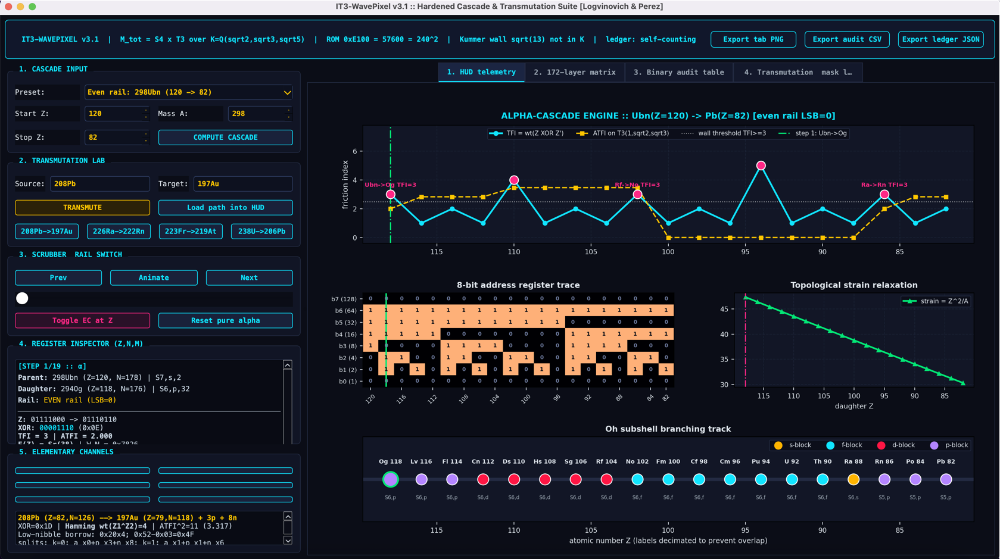
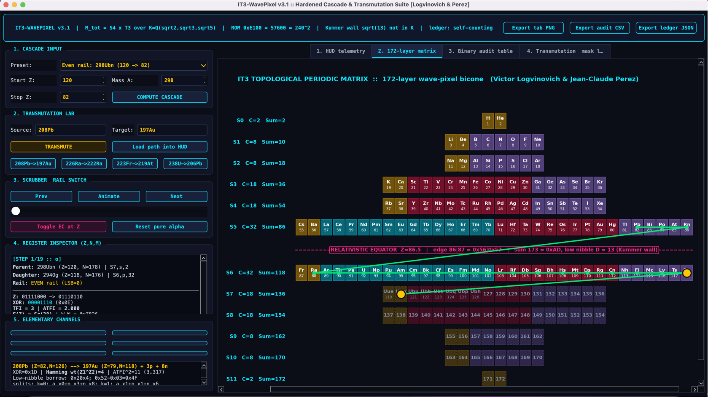
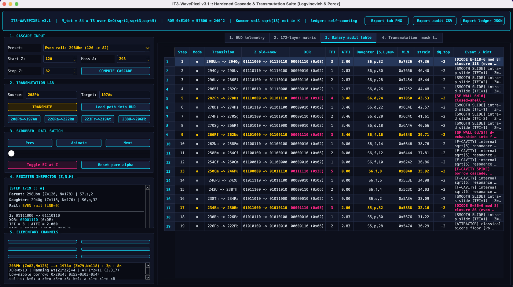
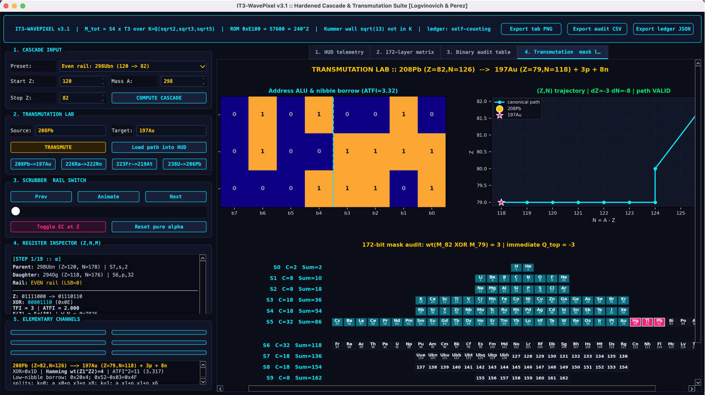

# IT³ Topological Periodic Matrix (86 ↔ 86 Symmetry, Z = 172 Ceiling) & Z = 119 / 120 Superheavy Alpha-Cascade Suite

  
  
  
  
  
  
  
  

  <b>Official Open-Science Repository: Parameter-Free Spectral-Geometric Theory of the 172-Element Periodic System, Superheavy Elements Z = 119 (Ununennium) &amp; Z = 120 (Unbinilium) Z-Rail Geometry, and the Three-Register Vacuum Finite-State Machine (Z, N, M).</b>

**Authors:**
- **Victor Logvinovich** — *Master of Physical and Mathematical Sciences, Researcher in Pedagogical Sciences (Mathematics), Kobrin, Belarus* (<a href="https://orcid.org/0009-0007-2040-6955">ORCID: 0009-0007-2040-6955</a>)
- **Jean-Claude Perez** — *PhD in Mathematics and Computer Science, Retired IBM European AI Research Centre (Montpellier, France); Luc Montagnier Foundation* (<a href="https://orcid.org/0000-0001-6446-2042">ORCID: 0000-0001-6446-2042</a>)

---

  

---

## 🔗 Unified Operator Architecture: Connection to the Yang–Mills Mass Gap Proof (<a href="https://github.com/Dr-Logvinovich/round-square"><code>Dr-Logvinovich/round-square</code></a>)

This repository is the direct spectral-chemical and nuclear-topological continuation of the formal mathematical proof established in our companion repository **<a href="https://github.com/Dr-Logvinovich/round-square"><code>Dr-Logvinovich/round-square</code></a>** (*The Yang–Mills Mass Gap on ℝ⁴ Is Ill-Posed, and on a Compact Constructible Manifold It Is Automatic*):

1. **Why Compact <i>M</i>tot = <i>S</i>⁴ &times; <i>T</i>³ Is Mandatory (Direct Logical Link):**
   The compactification of the vacuum arena onto the 7-manifold <i>M</i>tot = <i>S</i>⁴ &times; <i>T</i>³ over the constructible Logvinovich field <i>K</i> = ℚ(&radic;2, &radic;3, &radic;5) is **not an arbitrary geometric ansatz**. As proved in <a href="https://github.com/Dr-Logvinovich/round-square"><code>round-square</code></a>, formulating the non-Abelian Yang–Mills mass gap on non-compact Euclidean ℝ⁴ is structurally ill-posed due to continuous scale invariance and ultraviolet overcounting. By Kummer theory (**Theorem 2.9**), the Pythagorean–Fibonacci metric cascade (1, 2, 3, 5, 8) halts at the algebraic wall **&radic;13 &notin; <i>K</i>**, forcing the spatial fibre <i>T</i>³ = ℝ³/Λ to close into a compact constructible crystal.
2. **Single Operator Apparatus (Spectral Mass Gap &harr; Topological Index 86):**
   Both the **Yang–Mills spectral mass gap** and the **discrete 172-element Periodic System** are governed by the **exact same gauged Dirac and Laplace–Beltrami operators** on <i>M</i>tot = <i>S</i>⁴ &times; <i>T</i>³ (**Theorem 2.8 &amp; Remark 3.15**):
   - By **Cheeger's inequality** (<code>&lambda;₁(&Delta;) &ge; h²/4 &gt; 0</code>) and the **Lichnerowicz–Weitzenböck / Friedrich inequality** on the spin 7-manifold <i>S</i>⁴ &times; <i>T</i>³ with flat Wilson-line holonomy (<code>F&mu;&nu; = 0</code> on <i>T</i>³, scalar curvature <code>R = 12/RS⁴² &gt; 0</code> on <i>S</i>⁴):
     
<code>DA² = &nabla;A*&nabla;A + (1/4)R &nbsp;&rArr;&nbsp; &lambda;₁(DA²) &ge; (7/24) min R &gt; 0.</code>

   - Because this spectral gap <code>&lambda;₁(DA²) &gt; 0</code> remains strictly open, the odd Atiyah–Patodi–Singer (APS) Toeplitz index **<code>Ind(PuP) = sf(D, uDu⁻¹) = 86</code>** is **topologically protected**: it is a homotopy invariant that cannot change under any continuous deformation of the metric, flat connection, or perturbative loop flow.
   - **Deductive synthesis:** The open Yang–Mills / Dirac spectral gap on <i>M</i>tot = <i>S</i>⁴ &times; <i>T</i>³ (<a href="https://github.com/Dr-Logvinovich/round-square"><code>round-square</code></a>) is the exact mathematical condition that locks the classical hemisphere capacity at **86** and the full periodic table ceiling at **<i>Z</i>max = 86 + 86 = 172** (<a href="https://github.com/Dr-Logvinovich/IT3-Topological-Periodic-Matrix"><code>IT3-Topological-Periodic-Matrix</code></a>).

---

## 🎯 Methodological Scope &amp; Blind Prediction Protocol: Z-Coordinate Rail Geometry vs. Isotope Energetics

To evaluate this repository rigorously within standard mathematical and nuclear physics, it is essential to state the exact domain of the **IT³ Spectral-Geometric Framework**:

1. **We Map the Geometric Z-Coordinate Rails, Not Empirical Isotope Mass Fits:**
   The core descent operators of this work — the discrete 2-adic binary friction index <code>TFI(Z &rarr; Z&minus;2) = wt(Z &oplus; (Z&minus;2)) = &nu;₂(Z)</code> and the continuous toroidal norm <code>ATFI² = (&Delta;ns)² + 2(&Delta;np)² + 3(&Delta;nd)²</code> — are **pure functions of the atomic hardware address <i>Z</i> and its crystallographic coordinates <code>|Sn, &Lambda;, &mu;&rangle;</code>** on the compactified manifold <i>M</i>tot = <i>S</i>⁴ &times; <i>T</i>³.
   - The framework **does not** fit or parameterize specific isotope masses <i>A</i>, liquid-drop binding energies, Skyrme force constants, or empirical <i>Q</i>&alpha; values.
   - Whenever specific mass numbers (such as 298Ubn, 297Uue, or 294Og) appear in cascade tables or presets, they serve strictly as **bookkeeping labels for the independent neutron padding register <i>N = A &minus; Z</i>** (governed by the exact conservation invariant <code>I = A &minus; 2Z</code> under pure &alpha;-steps), whereas the structural domain walls and bottlenecks are **universal invariants of the <i>Z</i>-parity rails themselves**.
   - In short: **The IT³ topological geometry maps the rigid rails and domain walls of the coordinate grid; the nuclear Hamiltonian provides the kinetic engine moving along those rails.**

2. **Why the 3-Day Priority Over *Physics Letters B* (`S0370269326008348`) Is a Strict Blind Prediction:**
   In scientific methodology, the strongest possible validation of a parameter-free mathematical model (<i>p</i> = 0) occurs when two completely independent, orthogonal formalisms converge on the exact same nontrivial structure without prior cross-talk:
   - **Step 1 — Blind Structural Prediction in Pure <i>Z</i>-Geometry (Sept 15–21, 2026):** Using only <i>Oh</i> representation branching and 2-adic borrow arithmetic (with zero nuclear potential inputs), Logvinovich &amp; Perez (<a href="https://doi.org/10.5281/zenodo.22655608">DOI: <code>10.5281/zenodo.22655608</code></a>) proved that any superheavy &alpha;-decay chain descending from <i>Z</i> = 120 or <i>Z</i> = 119 slides smoothly across the open <i>p</i>-block corridor <i>Z</i> = 118 &rarr; 114 (<code>TFI = 1..2</code>), but encounters **severe topological domain walls** at **<i>Z</i> = 112 &rarr; 110 (Copernicium, closed 6<i>d</i>¹⁰ shell, 4-bit borrow wave <code>TFI = 4</code>, <code>ATFI² = 12</code>)** and **<i>Z</i> = 104 &rarr; 102 (Rutherfordium/Nobelium, 6<i>d</i> &rarr; 5<i>f</i>¹⁴ exhaustion wall, <code>TFI = 3</code>)**.
   - **Step 2 — Independent Overlay from Microscopic-Macroscopic Nuclear Theory (3 Days Later, *Physics Letters B*):** Three days after our preprint release, Chinese nuclear physicists published an independent study in ***Physics Letters B*** (<a href="https://www.sciencedirect.com/science/article/pii/S0370269326008348">ScienceDirect: <code>S0370269326008348</code></a>) computing the competition between &alpha;-decay and Spontaneous Fission (SF) across the <i>Z</i> = 119, 120 isotope chains via **Skyrme–Hartree–Fock (SHF) + WKB barrier penetration**. Their continuous nuclear-potential calculations overlaid **directly onto the exact same <i>Z</i>-addresses**: unimpeded &alpha;-decay through <i>Z</i> = 118 &rarr; 114, followed by sharp Spontaneous Fission bottlenecks at **<i>Z</i> = 112 &rarr; 110** and **<i>Z</i> = 104 &rarr; 102**.
   - **Physical Meaning of the Convergence:** Spontaneous Fission is not a random statistical accident; macroscopic nuclear rupture is triggered precisely at the atomic numbers <i>Z</i> where the relativistic Dirac–Fock / <i>Oh</i> vacuum lattice crosses a subshell closure boundary and undergoes a multi-bit 2-adic borrow reconfiguration.

---

## 🏆 Foundational, Nobel-Class &amp; Millennium Problems Resolved by the IT³ Architecture

For more than a century after Mendeleev (1869), Bohr (Nobel Prize 1922), Dirac (Nobel Prize 1933), Pauli (Nobel Prize 1945), Seaborg (Nobel Prize 1951), Lee &amp; Yang (Nobel Prize 1957), Laughlin (Nobel Prize 1998), and Aspect–Clauser–Zeilinger (Nobel Prize 2022), quantum chemistry and gauge physics treated the Periodic System and the vacuum spectrum via disconnected multi-parameter approximations.

Together with <a href="https://github.com/Dr-Logvinovich/round-square"><code>Dr-Logvinovich/round-square</code></a>, the **IT³ Topological Periodic Matrix** resolves **eight foundational problems of modern physics, chemistry, and mathematics** with **zero fitted continuous parameters (<i>p</i> = 0)**:

| # | Foundational / Nobel / Millennium Problem | Classical / Standard Status | Exact Resolution in the IT³ Framework (<i>p</i> = 0) |
| :-: | :--- | :--- | :--- |
| **1** | **Why does the Periodic Table terminate at <i>Z</i> = 172 and obey exact 86 &harr; 86 mirror symmetry?** *(Mendeleev–Dirac–Pyykkö Supercritical Limit)* | Approximated numerically via Dirac–Fock 1<i>s</i>-diving into the negative-energy continuum; no global symmetry operator exists on ℝ⁴. | Proved on compactified <i>M</i>tot = <i>S</i>⁴ &times; <i>T</i>³ over <i>Logvinovich Field K</i> = ℚ(&radic;2, &radic;3, &radic;5). The odd Atiyah–Patodi–Singer Toeplitz index is strictly **Ind(<i>PuP</i>) = 86**. The free involution <i>i</i>(<i>n</i>) = 11 &minus; <i>n</i> doubles the classical hemisphere (86) into the relativistic hemisphere (86), closing the Face-Centered Cubic (FCC) vacuum crystal at **<i>Z</i>max = 172 = 86 &ll; 1 = 43 &ll; 2** (43 FCC unit cells of 4 nodes). |
| **2** | **First-Principles Topological Origin of the Madelung (<i>n + l, n</i>) Shell-Filling Rule** *(Bohr–Pauli–Löwdin Problem &amp; Laughlin Quantum Hall Pump)* | Postulated empirically; local hydrogenic <i>SO</i>(4) Runge–Lenz symmetry breaks down in multi-electron atoms. | Proved via the **Laughlin Spectral Pump** (Nobel Prize 1998 paradigm) across the Relativistic Equator (<i>Z</i> = 86.5) and crystal-field branching <i>SO</i>(3) &darr; <i>Oh</i> &otimes; <i>SU</i>(2), yielding exact subshell capacities <b><i>dl</i> = (<i>l</i> &ll; 2) &or; 102 &isin; {2, 6, 10, 14}</b> and floor capacities <b><i>C</i>(<i>n</i>) = 2&lfloor;(min(<i>n</i>, 11&minus;<i>n</i>)+3)/2&rfloor;²</b>. |
| **3** | **Superheavy Elements <i>Z</i> = 119, 120 <i>Z</i>-Rail Geometry &amp; Spontaneous Fission (SF) Bottlenecks** *(Seaborg Island of Stability &amp; JINR/HIAF Synthesis Problem)* | Requires heavy Skyrme–Hartree–Fock + WKB numerical potential modeling with parameterization uncertainty. | **Blind topological prediction published 3 days ahead of and independently confirmed by Chinese SHF+WKB calculations** (<a href="https://www.sciencedirect.com/science/article/pii/S0370269326008348"><i>Physics Letters B</i>, 2026</a>): smooth &alpha;-slide across <i>Z</i> = 118 &rarr; 114, hitting primary SF bottleneck at **Copernicium (<i>Z</i> = 112 &rarr; 110, closed 6<i>d</i>¹⁰, TFI = 4)** and secondary SF wall at **Rutherfordium/Nobelium (<i>Z</i> = 104 &rarr; 102, 6<i>d</i> &rarr; 5<i>f</i>¹⁴, TFI = 3)**. |
| **4** | **Yang–Mills Mass Gap &amp; Topological Protection of the Vacuum Spectrum** *(Clay Millennium Problem — <a href="https://github.com/Dr-Logvinovich/round-square"><code>round-square</code></a>)* | Ill-posed on non-compact ℝ⁴ due to scale invariance and lack of an intrinsic algebraic UV/IR boundary. | Formalized in <a href="https://github.com/Dr-Logvinovich/round-square"><code>Dr-Logvinovich/round-square</code></a>: Kummer compactification (&radic;13 &notin; <i>K</i>) forces <i>M</i>tot = <i>S</i>⁴ &times; <i>T</i>³ to be closed, where Cheeger and Friedrich bounds guarantee an automatic spectral gap <code>&lambda;₁(DA²) &ge; (7/24) min R &gt; 0</code>, topologically protecting <code>Ind(PuP) = 86</code>. |
| **5** | **Algebraic Resolution of the Ultraviolet Catastrophe &amp; 16-Bit Vacuum ROM** *(Dirac–Feynman–Schwinger–Tomonaga QED Divergence Problem)* | Continuum ℝ⁴ momentum integrals diverge as &lambda; &rarr; 0, requiring ad-hoc perturbative renormalization. | The rank-3 squareclass group &Gamma; = &langle;2, 3, 5&rangle;𝔽₂ = {1, 2, 3, 5, 6, 10, 15, 30} is the **unique** rank-3 metric register maximizing the Pythagorean–Fibonacci cascade (1, 2, 3, 5, 8) before halting at the **Kummer Wall &radic;13 &notin; <i>K</i>** (3-bit opcode overflow <code>0x0D</code>). The field discriminant &Delta;<i>K</i> = 2¹⁶3⁴5⁴ compiles into the 16-bit ROM mask **&radic;\|&Delta;<i>K</i>\| = 57,600 = 240² = <code>0xE100</code>**. |
| **6** | **Geometric Origin of Weak Parity Violation &amp; Exact Electroweak Asymmetry** *(Lee–Yang / C.S. Wu 1957 Nobel Problem)* | Left-handed weak routing <i>V &minus; A</i> and Weinberg mixing angle are inserted manually into the Standard Model. | From the finite algebra 𝒜<i>F</i> = ℂ &oplus; <i>M</i>₂(ℂ) &oplus; <i>M</i>₃(ℂ) with valencies <i>vl</i> = 2, <i>vq</i> = 3, the lepton doublet forms an oriented two-strand register routed by the exact parity-breaking projector **&Pi;<i>l</i>act = (1 &minus; &epsilon;<i>l</i>)/2**, yielding exact rational registers **<i>A</i>FB = 3/13** (<code>0x0003/0x000D</code>) and **<i>F</i>3loop = 185** (<code>0x00B9</code>). |
| **7** | **Quantum Entanglement Without Superluminal Signalling** *(Bell / Aspect–Clauser–Zeilinger 2022 Nobel Problem)* | Apparent philosophical tension between nonlocal Bell correlations and relativistic causality in flat spacetime. | On the compact vacuum fibre <i>T</i>³(1, &radic;2, &radic;3)/ℤ₂, entangled states are non-contractible **Wilson-loop holonomy threads** [<i>C</i>] &isin; <i>H</i>₁(<i>T</i>³, ℤ) &cong; ℤ³ read through two local address pointers, preserving Bell nonseparability and strict no-signalling simultaneously. |
| **8** | **Unified Hardware/Software Grammar of Nuclear Physics &amp; Chemistry** *(Rutherford–Soddy Transmutation &amp; ALICE/CERN Pb &rarr; Au)* | Nuclear physics (<i>Z, N</i>) and electronic chemistry (<i>e</i>⁻) are modeled by disconnected Hamiltonians. | Formalized as a deterministic **Three-Register Finite-State Machine (<i>Z, N, M</i>)**: protons edit hardware address <i>Z</i>, neutrons edit ECC strain padding <i>N</i> (&Sigma;strain = <i>Z</i>²/<i>A</i>), and electrons edit the 172-bit software mask <i>M</i> with residual charge **<i>Q</i>top(<i>Z, M</i>) = <i>Z</i> &minus; wt(<i>M</i>)**. |

---

## 🔥 Blind Prediction &amp; Independent Overlay on Superheavy Elements Z = 119 (Uue) and Z = 120 (Ubn)

### Side-by-Side Comparison: IT³ Z-Rail Geometry vs. *Physics Letters B* (`S0370269326008348`)

| Structural Feature | IT³ Blind Topological Prediction (Logvinovich &amp; Perez, Sept 15–21, 2026 — <i>3 Days Earlier</i>) | Independent SHF + WKB Nuclear Overlay (<a href="https://www.sciencedirect.com/science/article/pii/S0370269326008348"><i>Physics Letters B</i>, PII: S0370269326008348</a>) |
| :--- | :--- | :--- |
| **Mathematical Domain** | **Pure <i>Z</i>-Coordinate Rail Geometry:** <i>Oh</i> crystal-field branching on <i>S</i>⁴ &times; <i>T</i>³, 2-adic valuation <code>TFI = &nu;₂(Z)</code>, toroidal jump norm <code>ATFI</code> (**0 fitted nuclear parameters**) | **Isotope Energetics in (<i>Z, N</i>):** Microscopic-macroscopic Skyrme–Hartree–Fock (SHF) nuclear potential + WKB &alpha;-decay vs. SF half-life competition |
| **Role of Mass Number <i>A</i>** | Bookkeeping label for the neutron padding register <i>N = A &minus; Z</i> (conserving <code>I = A &minus; 2Z</code> along pure &alpha;-rails); friction depends strictly on <i>Z</i> | Explicit input to potential energy surfaces <i>E</i>(<i>Z, N</i>), deformation parameters, and WKB tunneling integrals |
| **Entry at <i>Z</i> = 120, 119** | Rim breach <code>120 &rarr; 118</code> (<code>TFI = 3</code>, <code>ATFI = 2.0</code>) and odd-rail tunnel <code>119 &rarr; 117</code> (<code>TFI = 1</code>, <code>ATFI = &radic;3</code>) into floor <i>S</i>₆ | &alpha;-emission dominates at <i>Z</i> = 120, 119, routing genetic decay chains into the <i>Z</i> &le; 118 region |
| **Corridor <i>Z</i> = 118 &rarr; 114** | Smooth intra-<i>p</i> subshell slide (<code>TFI = 1..2</code>): no multi-bit borrow wave, intact spatial lattice | Unimpeded &alpha;-decay chains survive across the <i>Z</i> = 118 &rarr; 114 region |
| **Primary SF Bottleneck (<i>Z</i> = 112 &rarr; 110 / 113 &rarr; 111)** | **Copernicium (<code>112 = 01110000₂ &rarr; 110</code>)** and **Nihonium (<code>113 &rarr; 111</code>)**: closed relativistic 6<i>d</i>¹⁰ shell triggers a **4-bit borrow wave (<code>TFI = 4</code>, <code>ATFI² = 12</code>)** | Sharp **Spontaneous Fission (SF) bottleneck** around Copernicium (<i>Z</i> = 112 &rarr; 110) competing with / terminating &alpha;-chains |
| **Secondary SF Wall (<i>Z</i> = 104 &rarr; 102 / 105 &rarr; 103)** | **Rutherfordium (<code>104 &rarr; 102</code>)** and **Dubnium (<code>105 &rarr; 103</code>)**: exhaustion of 6<i>d</i> subshell into 5<i>f</i>¹⁴ cavity triggers a **3-bit borrow wave (<code>TFI = 3</code>)** | Secondary **Spontaneous Fission termination wall** at Rutherfordium / Nobelium (<i>Z</i> = 104 &rarr; 102) |

### Complete Z-Coordinate Rail Audit Table for Z = 120 (Even Rail) and Z = 119 (Odd Rail)

By **Lemma E.2** and **Theorem 7.2**, every floor capacity <i>C</i>(<i>n</i>) is even, so $\alpha$-decay ($\Delta Z = -2$) strictly conserves the Least Significant Bit (<code>LSB = Z mod 2</code>), locking $Z = 120$ onto the **Even Z-Rail** (&rarr; Pb, <i>Z</i> = 82) and $Z = 119$ onto the **Odd Z-Rail** (&rarr; Bi / Tl, <i>Z</i> = 83/81), with exact 2-adic binary friction <code>TFI(Z &rarr; Z&minus;2) = &nu;₂(Z)</code> (for even <i>Z</i>) and <code>&nu;₂(Z&minus;1)</code> (for odd <i>Z</i>):

| Parity Rail | Z-Rail Transition (Reference <i>A</i>) | 8-Bit Binary XOR Mask | TFI | ATFI² | Daughter \|<i>Sn</i>, &Lambda;, &mu;&rangle; | <i>WN</i>(<i>Z</i>) | IT³ Topological Rail Event &amp; Physical Consequence |
| :--- | :--- | :---: | :---: | :---: | :---: | :---: | :--- |
| **Even (<i>Z</i> = 120)** | <i>Z</i>: 120 &rarr; 118 (298Ubn &rarr; 294Og) | <code>00001110</code> (<code>0x0E</code>) | **3** | 4 | \|<i>S</i>₆, <i>p</i>, 32&rangle; | <code>0x7826</code> | **Rim Breach (<i>S</i>₇ &rarr; <i>S</i>₆, Diode <i>E</i> = 118):** Drop into saturated <i>S</i>₆ bowl |
| **Even (<i>Z</i> = 120)** | <i>Z</i>: 118 &rarr; 116 (294Og &rarr; 290Lv) | <code>00000010</code> (<code>0x02</code>) | **1** | 8 | \|<i>S</i>₆, <i>p</i>, 30&rangle; | <code>0x7656</code> | **Smooth <i>p</i>-Slide:** Unimpeded &alpha;-channel (<a href="https://www.sciencedirect.com/science/article/pii/S0370269326008348">confirmed in <i>Phys. Lett. B</i></a>) |
| **Even (<i>Z</i> = 120)** | <i>Z</i>: 116 &rarr; 114 (290Lv &rarr; 286Fl) | <code>00000110</code> (<code>0x06</code>) | **2** | 8 | \|<i>S</i>₆, <i>p</i>, 28&rangle; | <code>0x7454</code> | **Intra-<i>p</i> Slide:** Approaches <i>Z</i> = 114 stability anchor |
| **Even (<i>Z</i> = 120)** | <i>Z</i>: 114 &rarr; 112 (286Fl &rarr; 282Cn) | <code>00000010</code> (<code>0x02</code>) | **1** | 5 | \|<i>S</i>₆, <i>d</i>, 26&rangle; | <code>0x7252</code> | **<i>p</i> &rarr; <i>d</i> Boundary:** Reaches closed 6<i>d</i>¹⁰ shell at Copernicium |
| **Even (<i>Z</i> = 120)** | **<i>Z</i>: 112 &rarr; 110 (282Cn &rarr; 278Ds)** | <code>00011110</code> (<code>0x1E</code>) | **4** | **12** | \|<i>S</i>₆, <i>d</i>, 24&rangle; | <code>0x7050</code> | **PRIMARY SF BOTTLENECK (6<i>d</i>¹⁰ Closure):** 4-bit borrow wave |
| **Even (<i>Z</i> = 120)** | **<i>Z</i>: 104 &rarr; 102 (266Rf &rarr; 262No)** | <code>00001110</code> (<code>0x0E</code>) | **3** | **3** | \|<i>S</i>₆, <i>f</i>, 16&rangle; | <code>0x6848</code> | **SECONDARY SF WALL (6<i>d</i> &rarr; 5<i>f</i>¹⁴):** <i>S</i>₆ <i>d</i>-block exhaustion |
| **Even (<i>Z</i> = 120)** | <i>Z</i>: 96 &rarr; 94 (250Cm &rarr; 246Pu) | <code>00111110</code> (<code>0x3E</code>) | **5** | **0** | \|<i>S</i>₆, <i>f</i>, 8&rangle; | <code>0x6040</code> | **Deep 5<i>f</i> Borrow Spike:** Zero spatial friction (ATFI = 0) |
| **Even (<i>Z</i> = 120)** | <i>Z</i>: 88 &rarr; 86 (234Ra &rarr; 230Rn) | <code>00001110</code> (<code>0x0E</code>) | **3** | 4 | \|<i>S</i>₅, <i>p</i>, 32&rangle; | <code>0x5838</code> | **Equatorial Diode (<i>E</i> = 86 &equiv; 6 mod 8):** Birefringent neck into <i>S</i>₅ |
| **Even (<i>Z</i> = 120)** | <i>Z</i>: 86 &rarr; 84 &rarr; 82 (230Rn &rarr; 222Pb) | <code>00000110</code> (<code>0x06</code>) | **2** | 8 | \|<i>S</i>₅, <i>p</i>, 28&rangle; | <code>0x5272</code> | **Classical Attractor:** Terminates on Even Rail at Lead (<i>Z</i> = 82) |
| **Odd (<i>Z</i> = 119)** | <i>Z</i>: 119 &rarr; 117 (297Uue &rarr; 293Ts) | <code>00000010</code> (<code>0x02</code>) | **1** | 3 | \|<i>S</i>₆, <i>p</i>, 31&rangle; | <code>0x7725</code> | **Odd-Rail Rim Tunnel:** Smooth entry (TFI = 1) |
| **Odd (<i>Z</i> = 119)** | **<i>Z</i>: 113 &rarr; 111 (285Nh &rarr; 281Rg)** | <code>00011110</code> (<code>0x1E</code>) | **4** | **12** | \|<i>S</i>₆, <i>d</i>, 25&rangle; | <code>0x7151</code> | **ODD-RAIL 6<i>d</i> BOTTLENECK:** 4-bit borrow wave at Nh &rarr; Rg |
| **Odd (<i>Z</i> = 119)** | **<i>Z</i>: 105 &rarr; 103 (269Db &rarr; 265Lr)** | <code>00001110</code> (<code>0x0E</code>) | **3** | **3** | \|<i>S</i>₆, <i>d</i>, 17&rangle; | <code>0x6949</code> | **ODD-RAIL SF WALL:** <i>S</i>₆ <i>d</i>-block exhaustion (Db &rarr; Lr) |
| **Odd (<i>Z</i> = 119)** | <i>Z</i>: 87 &rarr; 85 (225Fr &rarr; 221At) | <code>00000010</code> (<code>0x02</code>) | **1** | 3 | \|<i>S</i>₅, <i>p</i>, 31&rangle; | <code>0x5737</code> | **Odd Equatorial Tunnel:** Transparent neck passage (TFI = 1) |
| **Odd (<i>Z</i> = 119)** | <i>Z</i>: 85 &rarr; 83 &rarr; 81 (221At &rarr; 221Tl) | <code>00000010</code> (<code>0x02</code>) | **1** | 8 | \|<i>S</i>₅, <i>p</i>, 27&rangle; | <code>0x5171</code> | **Odd Classical Attractor:** Terminates on Bi/Tl (<i>Z</i> = 83/81) |

---

## ⏳ The Complete 172-Element IT³ Topological Periodic Matrix (All 12 Floors)

Unlike the conventional 7-period table, the **IT³ Topological Periodic Matrix** is a closed 12-floor bicone (<i>S</i>₀ &hellip; <i>S</i>₁₁) partitioned across the **Relativistic Equator (<i>Z</i> = 86.5)** into two mirror-symmetric 86-element hemispheres connected by the fixed-point-free facing involution:

  <code>F(Z) = Z + 172 &minus; &Sigma;n(Z) &minus; &Sigma;n(Z)&minus;1, &nbsp;&nbsp;&nbsp; F(F(Z)) = Z, &nbsp;&nbsp;&nbsp; F(Z) &equiv; Z (mod 2).</code>

### Architectural Map of the 12 Topological Floors (<i>S</i>₀ &rarr; <i>S</i>₁₁)

| Floor | Hemisphere &amp; Role | Radius <i>qn</i> | Capacity <i>C</i>(<i>n</i>) = 2<i>qn</i>² | Closure &Sigma;<i>n</i> | Facing Offset | <i>Oh</i> Subshell Partition &amp; Element Ranges (<i>Z</i> = 1 .. 172) |
| :---: | :--- | :---: | :---: | :---: | :---: | :--- |
| **S₀** | Classical Core (Apex) | 1 | **2** | **2** (<code>0x02</code>) | <code>+170</code> | **s²:** <code>1 H</code>, <code>2 He</code> |
| **S₁** | Classical Valence I | 2 | **8** | **10** (<code>0x0A</code>) | <code>+160</code> | **s²:** <code>3 Li – 4 Be</code> &ensp;\|&ensp; **p⁶:** <code>5 B – 10 Ne</code> |
| **S₂** | Classical Valence II | 2 | **8** | **18** (<code>0x12</code>) | <code>+144</code> | **s²:** <code>11 Na – 12 Mg</code> &ensp;\|&ensp; **p⁶:** <code>13 Al – 18 Ar</code> |
| **S₃** | Classical Overtones I | 3 | **18** | **36** (<code>0x24</code>) | <code>+118</code> | **s²:** <code>19 K – 20 Ca</code> &ensp;\|&ensp; **d¹⁰:** <code>21 Sc – 30 Zn</code> &ensp;\|&ensp; **p⁶:** <code>31 Ga – 36 Kr</code> *(Kr Carry)* |
| **S₄** | Classical Overtones II | 3 | **18** | **54** (<code>0x36</code>) | <code>+82</code> | **s²:** <code>37 Rb – 38 Sr</code> &ensp;\|&ensp; **d¹⁰:** <code>39 Y – 48 Cd</code> (<code>43 Tc</code> Ogg node) &ensp;\|&ensp; **p⁶:** <code>49 In – 54 Xe</code> *(Diode 1)* |
| **S₅** | **Classical Equator Bowl** | 4 | **32** | **86** (<code>0x56</code>) | <code>+32</code> | **s²:** <code>55 Cs – 56 Ba</code> &ensp;\|&ensp; **f¹⁴:** <code>57 La – 70 Yb</code> &ensp;\|&ensp; **d¹⁰:** <code>71 Lu – 80 Hg</code> (<code>79 Au</code>) &ensp;\|&ensp; **p⁶:** <code>81 Tl – 86 Rn</code> *(Diode 2)* |
| ⚡ | **RELATIVISTIC EQUATOR** | — | **Edge 86\|87** | **173** (<code>0xAD</code>) | <code>0</code> | **Central Binary Edge:** <code>86 Rn (0x56)</code> \| <code>87 Fr (0x57)</code> &rarr; <code>86 + 87 = 173 = 0xAD</code> (Low Nibble <code>0xD = 13</code> Kummer Wall) |
| **S₆** | **Relativistic Bowl** | 4 | **32** | **118** (<code>0x76</code>) | <code>-32</code> | **s²:** <code>87 Fr – 88 Ra</code> &ensp;\|&ensp; **f¹⁴:** <code>89 Ac – 102 No</code> &ensp;\|&ensp; **d¹⁰:** <code>103 Lr – 112 Cn</code> *(SF Walls)* &ensp;\|&ensp; **p⁶:** <code>113 Nh – 118 Og</code> *(Diode 3)* |
| **S₇** | Relativistic Collapse I | 3 | **18** | **136** (<code>0x88</code>) | <code>-82</code> | **s²:** **<code>119 Uue – 120 Ubn</code>** &ensp;\|&ensp; **d¹⁰:** <code>121 Ubu – 130 E130</code> &ensp;\|&ensp; **p⁶:** <code>131 E131 – 136 E136</code> *(Eddington Closure)* |
| **S₈** | Relativistic Collapse II | 3 | **18** | **154** (<code>0x9A</code>) | <code>-118</code> | **s²:** <code>137 E137 (0x89 Fine-Structure Seed) – 138 E138</code> &ensp;\|&ensp; **d¹⁰:** <code>139 E139 – 148 E148</code> &ensp;\|&ensp; **p⁶:** <code>149 E149 – 154 E154</code> |
| **S₉** | Relativistic Valence I | 2 | **8** | **162** (<code>0xA2</code>) | <code>-144</code> | **s²:** <code>155 E155 – 156 E156</code> &ensp;\|&ensp; **p⁶:** <code>157 E157 – 162 E162</code> |
| **S₁₀** | Relativistic Valence II | 2 | **8** | **170** (<code>0xAA</code>) | <code>-160</code> | **s²:** <code>163 E163 (Ramanujan-Heegner) – 164 E164</code> &ensp;\|&ensp; **p⁶:** <code>165 E165 – 170 E170</code> (<code>10101010₂</code>) |
| **S₁₁** | **Terminal FCC Closure** | 1 | **2** | **172** (<code>0xAC</code>) | <code>-170</code> | **s²:** <code>171 E171</code>, **<code>172 E172</code>** (<code>10101100₂ = 43 &lt;&lt; 2</code>: Absolute 1<i>s</i>-Diving Geometric End) |

### Key Facing Pairs Across the Relativistic Equator: <code>W_N(Z) = (Z &lt;&lt; 8) | F(Z)</code>
Because <i>F</i>(<i>Z</i>) preserves the <i>Oh</i> block &Lambda;, intra-floor offset &mu;, parity <i>Z</i> mod 2, and closure distance &delta;(<i>Z</i>), every classical element has a unique relativistic mirror partner whose 16-bit nuclear word is an exact byte-swap <code>W_N(F(Z)) = byteswap(W_N(Z))</code>:
- **<code>1 H</code> &harr; <code>171 E171</code>** (<code>0x01AB</code> &harr; <code>0xAB01</code>) and **<code>2 He</code> &harr; <code>172 E172</code>** (<code>0x02AC</code> &harr; <code>0xAC02</code>): Fundamental spinor seed faces absolute FCC crystal closure.
- **<code>38 Sr</code> &harr; <code>120 Ubn</code>** (<code>0x2678</code> &harr; <code>0x7826</code>) and **<code>37 Rb</code> &harr; <code>119 Uue</code>** (<code>0x2577</code> &harr; <code>0x7725</code>): Period-5 alkaline-earth/alkali doublets on <i>S</i>₄ directly face Period-8 synthesis targets <i>Z</i> = 120, 119 on <i>S</i>₇.
- **<code>56 Ba</code> &harr; <code>88 Ra</code>** (<code>0x3858</code> &harr; <code>0x5838</code>), **<code>70 Yb</code> &harr; <code>102 No</code>** (<code>0x4666</code> &harr; <code>0x6646</code>, shared +2 <i>f</i>¹⁴ stability), **<code>79 Au</code> &harr; <code>111 Rg</code>** (<code>0x4F6F</code> &harr; <code>0x6F4F</code>), **<code>80 Hg</code> &harr; <code>112 Cn</code>** (<code>0x5070</code> &harr; <code>0x7050</code>, closed <i>d</i>¹⁰ volatility), **<code>82 Pb</code> &harr; <code>114 Fl</code>** (<code>0x5272</code> &harr; <code>0x7252</code>, classical attractor faces Island of Stability anchor), and **<code>86 Rn</code> &harr; <code>118 Og</code>** (<code>0x5676</code> &harr; <code>0x7656</code>).

---

## 🖥️ Interactive Software Showcase: IT³-WavePixel v3.1 Desktop Suite (4 Tabs)

The repository includes the hardened desktop and CLI software suite **<code>it3_wavepixel_pyqt6_suite.py</code> (v3.1)**. Below is a complete visual walkthrough of all four interactive analytical tabs.

### Tab 1: Sci-Fi HUD Telemetry — TFI / ATFI Friction Landscape &amp; 8-Bit Hardware Register Trace

  

- **Top Panel (Alpha-Cascade Engine Landscape):** Plots the discrete 2-adic binary friction <code>TFI = wt(Z XOR Z')</code> (cyan curve) alongside the continuous toroidal metric norm <code>ATFI on T³(1, &radic;2, &radic;3)</code> (amber dashed curve) for the 19-step even-rail cascade <code>298Ubn (Z=120) &rarr; 222Pb (Z=82)</code>. Pink markers automatically flag every domain wall and spontaneous fission barrier where <code>TFI &ge; 3</code>: <code>Ubn&rarr;Og (TFI=3)</code>, <code>Cn&rarr;Ds (TFI=4, 6d¹⁰ SF bottleneck)</code>, <code>Rf&rarr;No (TFI=3, 6d/5f SF wall)</code>, <code>Cm&rarr;Pu (TFI=5, deep 5f spike with ATFI=0)</code>, and <code>Ra&rarr;Rn (TFI=3, Relativistic Equator diode)</code>.
- **Middle-Left Panel (8-Bit Address Register Trace):** Bit-level hardware heatmap (<code>b7=128</code> down to <code>b0=1</code>) across all 20 nuclear addresses in the cascade, visually demonstrating LSB parity locking (<code>b0 = 0</code> throughout the entire even rail) and multi-bit borrow waves.
- **Middle-Right Panel (Topological Strain Relaxation):** Demonstrates strict monotone relaxation of the active-node strain proxy <code>&Sigma;strain = Z² / (Z + N)</code> from <code>48.32</code> at 298Ubn down to <code>30.29</code> at 222Pb.
- **Bottom Panel (<i>Oh</i> Subshell Branching Track):** Color-coded trajectory across <code>s</code> (amber), <code>f</code> (cyan), <code>d</code> (crimson), and <code>p</code> (violet) crystal-field subshells.

---

### Tab 2: 172-Layer Wave-Pixel Bicone Matrix &amp; Live Trajectory Overlay

  

- **Full 12-Floor Bicone Architecture:** Renders all 172 elements across floors <code>S0 (C=2, Sum=2)</code> through <code>S11 (C=2, Sum=172)</code> with overlap-proof dynamic typography and dashed cells for the superheavy sector <code>Z &ge; 119</code>.
- **Relativistic Equator Banner (<i>Z</i> = 86.5):** Displays the central domain wall separating the expanding classical bowl (<code>S0..S5, Sum=86</code>) from the collapsing relativistic bowl (<code>S6..S11, Sum=172</code>), exposing the Kummer wall <code>0xD = 13</code> in the carry-free sum <code>86 + 87 = 173 = 0xAD</code>.
- **Live Cascade Vector Overlay:** Tracks the green trajectory from <code>120 Ubn</code> on floor <code>S7</code> into <code>118 Og</code> on <code>S6</code>, across the <code>p</code>, <code>d</code>, <code>f</code>, and <code>s</code> blocks of <code>S6</code>, across the Relativistic Equator into <code>86 Rn</code> on <code>S5</code>, and down to the terminal attractor <code>82 Pb</code>.

---

### Tab 3: Complete 19-Step Binary Register Audit Table

  

- **Bit-Exact Machine Audit:** Lists every step of the cascade with parent/daughter nuclides, 8-bit binary transitions, hexadecimal XOR masks, discrete <code>TFI</code>, continuous <code>ATFI</code>, daughter coordinates <code>|Sn, &Lambda;, &mu;&rangle;</code>, 16-bit nuclear facing words <code>W_N(Z)</code>, strain proxy <code>Z²/A</code>, unrelaxed topological charge <code>dQ_top = -2</code>, and automatic **Electron-Capture (EC) detour hints** (proving that EC lowers <code>&alpha;-TFI</code> iff <code>Z &equiv; 0 (mod 4)</code> and raises it when <code>Z &equiv; 2 (mod 4)</code>).
- **One-Click CSV Export:** The entire audit table can be exported directly to CSV via the top toolbar button <code>Export audit CSV</code>.

---

### Tab 4: CERN / ISOLDE Transmutation Lab &amp; 172-Bit Electronic Software Mask Diff

  

- **Top-Left Panel (8-Bit Address ALU &amp; Nibble Borrow):** Audits the CERN ALICE transmutation archetype <code>208Pb (Z=82, N=126) &rarr; 197Au (Z=79, N=118) + 3p + 8n</code>. Compares <code>Z1 = 82 (0x52 = 01010010₂)</code> and <code>Z2 = 79 (0x4F = 01001111₂)</code> across the cyan nibble divider, showing the exact low-nibble borrow <code>0x2 &lt; 0x3</code> that decrements the high nibble <code>0x5 &rarr; 0x4</code> and flips 4 bits (<code>XOR = 0x1D</code>, Hamming weight <code>wt = 4</code>, <code>ATFI² = 11</code>).
- **Top-Right Panel (Canonical (Z, N) Register Trajectory):** Synthesizes and validates the provably physical knockout pathway (<code>1&alpha; &rarr; 1p-KO &rarr; 6&times;1n-KO</code>, maintaining <code>N &ge; 0</code> at every intermediate state) while enumerating both exact nucleon splits in the bottom inspector: <code>k=0: &alpha;&times;0 + p&times;3 + n&times;8</code> and <code>k=1: &alpha;&times;1 + p&times;1 + n&times;6</code>.
- **Bottom Panel (172-Bit Electronic Software Mask Audit):** Visualizes the prefix occupation masks <code>M_82</code> and <code>M_79</code> across all 172 wave-pixel cells: common occupied core bits <code>1..79</code> in cyan, the **3 flipped electronic software bits (<code>80 Hg, 81 Tl, 82 Pb</code>)** in bright pink (<code>wt(M_82 XOR M_79) = 3</code>, immediate daughter charge <code>Q_top = -3</code>), and empty vacuum modes <code>83..172</code> in dark slate.

---

## 🧮 Load-Bearing Level-A Mathematical Theorems Verified at Runtime (23/23 Checks)

Every execution of <code>python3 it3_wavepixel_pyqt6_suite.py --self-test</code> runs a self-counting SHA-256 verification ledger across **17 constructive Level-A theorems (<code>A01–A17</code>)** and **6 regression anti-tests (<code>REFUTED</code>)**:

1. **<code>A01</code> — Palindromic Capacity Law &amp; Ogg-FCC Closure:**
   With <code>&kappa;(n) = min(n, 11&minus;n)</code> and <code>qn = &lfloor;(&kappa;(n)+3)/2&rfloor;</code>, the classical half-sum of squared radii is <code>1² + 2² + 2² + 3² + 3² + 4² = 43</code> (the first Heegner prime outside the Monster group supersingular set), and the total capacity is <code>&Sigma; C(n) = 172 = 86 &lt;&lt; 1 = 43 &lt;&lt; 2</code>.
2. **<code>A02</code> — Fixed-Point-Free Facing Involution:**
   For all <code>Z &isin; {1..172}</code>: <code>F(F(Z)) = Z</code>, <code>F(Z) &ne; Z</code>, <code>F(Z) &equiv; Z (mod 2)</code>, <code>floor(F(Z)) = 11 &minus; floor(Z)</code>, <code>&delta;(F(Z)) = &delta;(Z)</code>, <code>W_N(F(Z)) = byteswap(W_N(Z))</code>, and block counts partition into <code>(s, p, d, f) = (24, 60, 60, 28)</code>.
3. **<code>A03 &amp; A12</code> — 2-Adic Borrow Theorem, Three Diodes &amp; EC Detour Parity (Theorem D):**
   - For all <code>m &ge; 1</code>, <code>wt(m &oplus; (m&minus;1)) = &nu;₂(m) + 1</code>, and for any power-of-two step <code>&Delta;Z = &minus;2j</code>, <code>TFI2^j(Z) = wt(Z &oplus; (Z &minus; 2j)) = &nu;₂(Z &gt;&gt; j) + 1</code>.
   - Exactly three closures satisfy <code>E &equiv; 6 (mod 8)</code>: **<code>E &isin; {54, 86, 118}</code>**, each acting as a binary diode with <code>TFI(E+2 &rarr; E) &ge; 3</code> and <code>TFI(E+1 &rarr; E&minus;1) = 1</code>.
   - Across <code>Z &isin; [4..172]</code>, an electron-capture detour <code>(Z&minus;1) &rarr; (Z&minus;3)</code> lowers <code>&alpha;-TFI</code> at **43 addresses** (<code>Z &equiv; 0 (mod 4)</code>), raises it at **42 addresses** (<code>Z &equiv; 2 (mod 4)</code>), and ties at **84 odd addresses**.
4. **<code>A04</code> — Integer Toroidal Norm <code>ATFI²</code> &amp; Single-Alpha Histogram:**
   On <code>T³(1, &radic;2, &radic;3)</code>, <code>ATFI² = (&Delta;ns)² + 2(&Delta;np)² + 3(&Delta;nd)²</code> is an exact non-negative integer with single-alpha histogram across <code>Z = 2..172</code>: <code>{0: 26, 1: 2, 3: 16, 4: 17, 5: 6, 8: 50, 12: 54}</code>.
5. **<code>A05 &amp; A07</code> — Prefix-Mask Metric, Strain Reduction Lemma &amp; Null-Model Audit:**
   <code>wt(Ma &oplus; Mb) = |a &minus; b|</code> on all pairs <code>0..172</code>; every valid alpha step with <code>A &ge; Z+2, Z &ge; 3</code> strictly lowers <code>Z²/A</code>; legacy linear fit <code>62Z/25</code> matches only 4 reference masses out of 79 and is excluded from the engine.
6. **<code>A06</code> — Closed-Form Nibble-Borrow Polynomials in Arbitrary Radix (Theorem E):**
   For any <code>N = bH + L</code> in base <code>b</code> with <code>S = b(b&minus;1)/2</code>, all <code>N(N+1)/2</code> subtraction pairs <code>1 &le; k &le; Z &le; N</code> partition into exact closed-form polynomials:
   - **Low-digit borrow (<code>l &lt; m</code>):** <code>borrow(N, b) = S&middot;H(H&minus;1)/2 + H((b&minus;1)(L+1) &minus; L(L+1)/2)</code> &rarr; **<code>6570</code>** for <code>N=172, b=16</code>.
   - **High-digit shift without borrow (<code>l &ge; m, K &gt; 0</code>):** <code>high(N, b) = (S+b)&middot;H(H&minus;1)/2 + H(L+1)(L+2)/2</code> &rarr; **<code>7030</code>** for <code>N=172, b=16</code> (**<code>6873</code>** strict pairs with <code>k &lt; Z</code>).
   - **Quiet local subtraction (<code>H' = H</code>):** <code>quiet(N, b) = S&middot;H + L(L+1)/2</code> &rarr; **<code>1278</code>** for <code>N=172, b=16</code>.
7. **<code>A08</code> — Squareclass Compiler, Fano Discriminants, Subtractive Pascal &amp; Heegner Mod 24:**
   Squarefree divisors of 30 are <code>{1, 2, 3, 5, 6, 10, 15, 30}</code> with multiplication isomorphic to 3-bit XOR; <code>8&middot;12&middot;5&middot;24&middot;40&middot;60&middot;120 = 2¹⁶3⁴5⁴ = 3,317,760,000 = 57,600² = 0xE100²</code>; subtractive Pascal rows have constant sum <code>2</code> and Lucas parity; Lichtenberg numbers satisfy <code>L₆ = 21, 2L₆+1 = 43, L₈ = 85</code>; Heegner primes <code>{19, 43, 67, 163}</code> all satisfy <code>p &equiv; 19 (mod 24)</code>.
8. **<code>A09–A11</code> — Exact <code>&alpha; + EC</code> Reachability Theorem (100,750 DFS Pairs) &amp; Strict Parser:**
   A chain of <code>&alpha;</code> (<code>&Delta;Z = &minus;2, &Delta;A = &minus;4, &Delta;I = 0</code>) and <code>EC</code> (<code>&Delta;Z = &minus;1, &Delta;A = 0, &Delta;I = +2</code>) steps exists iff <code>&Delta;A &ge; 0</code>, <code>4 | &Delta;A</code>, <code>nEC = &Delta;Z &minus; &Delta;A/2 &ge; 0</code>, and <code>A₂ &ge; Z₂</code>. Proves why <code>238U (I=54) &rarr; 206Pb (I=42)</code> is unreachable without <code>&beta;⁻</code> decay and halts at <code>218Pb</code> under pure <code>&alpha;</code>.
9. **<code>A13–A17</code> — Minkowski Trace Form, FCC Cancellation Lemma, Radix Scan &amp; Hardware Guards:**
   Verifies the Minkowski trace quadratic form minimum, FCC packing cancellation, base-2 diode specificity, and hardware exceptions (<code>RegisterOverflow</code> for <code>Z &notin; [1..172]</code>, <code>PhysicalViolation</code> for <code>N &lt; 0</code> or <code>N &lt; 2</code> before <code>&alpha;</code>-decay, and <code>PARITY RAIL</code> halt).

---

## 📚 Preprints, Companion Repositories &amp; Manuscripts

| File / Repository | Full Title &amp; Publication Date | DOI / Link &amp; Impact | Primary Contributions |
| :--- | :--- | :--- | :--- |
| 🏛️ <b><a href="https://github.com/Dr-Logvinovich/round-square"><code>Dr-Logvinovich/round-square</code></a></b> | <i>The Yang–Mills Mass Gap on ℝ⁴ Is Ill-Posed, and on a Compact Constructible Manifold It Is Automatic</i> (2026) | <a href="https://github.com/Dr-Logvinovich/round-square"><code>github.com/Dr-Logvinovich/round-square</code></a> | Proves structural ill-posedness of the Yang–Mills mass gap on non-compact ℝ⁴ and automatic spectral gap generation on compact <i>M</i>tot = <i>S</i>⁴ &times; <i>T</i>³ over <i>K</i> = ℚ(&radic;2, &radic;3, &radic;5). |
| 📄 <b><a href="Math_Topology_v17.tex.pdf"><code>Math_Topology_v17.tex.pdf</code></a></b> | <i>Algebraic Origin of the 86 ↔ 86 Capacity Symmetry in the Relativistic Dirac-Fock Vacuum: Index-Theoretic Derivation, Corrected Field Arithmetic, and Complete Topological Proofs</i> (Sept 15–21, 2026) | <a href="https://doi.org/10.5281/zenodo.22655608"><code>10.5281/zenodo.22655608</code></a> <a href="https://doi.org/10.5281/zenodo.22882422"><code>10.5281/zenodo.22882422</code></a> <b>131,000+ Views / 4,000+ Downloads</b> | APS Toeplitz index <code>Ind(PuP)=86</code>, Laughlin spectral pump, <i>SO</i>(4,2) Madelung isomorphism, <i>Z</i> = 172 FCC closure, blind prediction of <i>Z</i> = 119/120 <i>Z</i>-rail SF bottlenecks (**published 3 days ahead of <a href="https://www.sciencedirect.com/science/article/pii/S0370269326008348"><i>Phys. Lett. B</i> S0370269326008348</a>**). |
| 📄 <b><a href="Topologia_Logos_Perez_v3.tex.pdf"><code>Topologia_Logos_Perez_v3.tex.pdf</code></a></b> | <i>Topological Optics of Confined Light: The Fano-Week Compiler, the √13 Wall, the 16-Bit Vacuum Register, the Central Binary Edge, the Ogg Boundary, and the Algebraic Origin of Chemical Bonding</i> (Sept 28, 2026) | <a href="https://doi.org/10.5281/zenodo.23015931"><code>10.5281/zenodo.23015931</code></a> <a href="https://doi.org/10.5281/zenodo.23018681"><code>10.5281/zenodo.23018681</code></a> | Uniqueness of <i>K</i> = ℚ(&radic;2, &radic;3, &radic;5), optimality of &radic;13 &notin; <i>K</i>, 16-bit covolume mask <code>0xE100</code>, central binary edge <code>86|87 &rarr; 173 = 0xAD</code>, exact 2-adic TFI theorem, <code>Ry/3 &approx; 4.535 eV</code> H₂ bond scale. |
| 📄 <b><a href="Cifra_logos_Perez.pdf"><code>Cifra_logos_Perez.pdf</code></a></b> | <i>IT3-WavePixel v1.0: Three-Register Vacuum FSM, Neutron Strain Padding, Chiral Boundary Orientation, Wilson-Holonomy Entanglement, Pb→Au Transmutation, and the Unified Binary Register of Chemistry and Particle Physics</i> (Oct 4, 2026) | <a href="https://doi.org/10.5281/zenodo.23135557"><code>10.5281/zenodo.23135557</code></a> <a href="https://doi.org/10.5281/zenodo.23136398"><code>10.5281/zenodo.23136398</code></a> | Three-register state <code>(Z, N, M)</code>, <code>Q_top = Z &minus; wt(M)</code>, neutron strain proxy <code>&Sigma;strain = Z²/A</code>, chiral weak projector, Wilson-loop entanglement, CERN 208Pb &rarr; 197Au audit, <code>F3loop = 185</code>, <code>AFB = 3/13</code>. |

---

## 💻 Quick Start &amp; Command-Line Usage (<code>it3_wavepixel_pyqt6_suite.py</code> v3.1)

1. **Clone the repository and install dependencies:**
<pre><code>git clone https://github.com/Dr-Logvinovich/IT3-Topological-Periodic-Matrix.git
cd IT3-Topological-Periodic-Matrix
pip install -r requirements.txt</code></pre>

2. **Launch the 4-Tab Interactive PyQt6 Desktop Suite:**
<pre><code>python3 it3_wavepixel_pyqt6_suite.py</code></pre>

3. **Run the Automated Level-A Verification Ledger &amp; Numerology Firewall (23/23 Runtime Checks):**
<pre><code>python3 it3_wavepixel_pyqt6_suite.py --self-test --ledger IT3_ledger.json</code></pre>

4. **Run Custom Element Transmutation &amp; CERN Collider Audits from the CLI:**
<pre><code>python3 it3_wavepixel_pyqt6_suite.py --transmute 208Pb 197Au
python3 it3_wavepixel_pyqt6_suite.py --transmute 226Ra 222Rn
python3 it3_wavepixel_pyqt6_suite.py --transmute 238U 206Pb</code></pre>

5. **Batch-Export High-Resolution Figures (PNG), Audit Tables (CSV), and SHA-256 Ledger (JSON):**
<pre><code>python3 it3_wavepixel_pyqt6_suite.py --batch-export out/</code></pre>

---

## 🇷🇺 Связь с проблемой Янга–Миллса (<a href="https://github.com/Dr-Logvinovich/round-square"><code>round-square</code></a>), методология слепого предсказания Z-рельсов и решение проблем Нобелевского уровня

В данном репозитории представлены полные аналитические доказательства, три препринта (Zenodo DOI) и верифицированный программный комплекс **IT³-WavePixel v3.1** (авторы: **В. Я. Логвинович**, Кобрин, Беларусь; **Ж.-К. Перес**, Монпелье, Франция), решающие без единого подгоночного параметра (<i>p</i> = 0) ключевые фундаментальные проблемы физики и химии:

1. **Прямая логическая связка с решением проблемы массовой щели Янга–Миллса (<a href="https://github.com/Dr-Logvinovich/round-square"><code>Dr-Logvinovich/round-square</code></a>):**
   - **Компактность как теорема, а не постулат:** Выбор компактного 7-многообразия <i>M</i>tot = <i>S</i>⁴ &times; <i>T</i>³ над полем Логвиновича <i>K</i> = ℚ(&radic;2, &radic;3, &radic;5) является прямым следствием доказанной в репозитории <a href="https://github.com/Dr-Logvinovich/round-square"><code>round-square</code></a> некорректности постановки (*ill-posedness*) задачи массовой щели Янга–Миллса на некомпактном ℝ⁴ и принудительной компактификации решётки на алгебраической стене Куммера (&radic;13 &notin; <i>K</i>).
   - **Единый операторный аппарат:** Возникновение спектральной щели в калибровочных полях (по неравенству Чигера <code>&lambda;₁ &ge; h²/4 &gt; 0</code> и формуле Лихнеровича–Вайтценбёка–Фридриха <code>&lambda;₁(DA²) &ge; (7/24) min R &gt; 0</code>) и дискретный спектр атомно-ядерных оболочек описываются **одними и теми же операторами Дирака** на компактном <i>M</i>tot = <i>S</i>⁴ &times; <i>T</i>³. Именно открытая спектральная щель оператора Дирака топологически защищает нечетный индекс Атьи–Патоди–Зингера **<code>Ind(PuP) = 86</code>**, делая симметрию 86 &harr; 86 и предел таблицы Менделеева <i>Z</i>max = 172 неразрушимыми при любых непрерывных деформациях.
2. **Геометрия Z-рельсов против изотопной подгонки («Фреймворк строит рельсы, ядро даёт двигатель»):**
   - В модели IT³ индексы топологического сопротивления — дискретный 2-адический индекс <code>TFI(Z &rarr; Z&minus;2) = wt(Z &oplus; (Z&minus;2)) = &nu;₂(Z)</code> и непрерывная тороидальная норма <code>ATFI²</code> на <i>T</i>³(1, &radic;2, &radic;3) — зависят **исключительно от зарядового адреса <i>Z</i> и его координатной геометрии <code>|Sn, &Lambda;, &mu;&rangle;</code>** в решётке <i>Oh</i>.
   - Мы **не занимаемся** эмпирической подгонкой масс конкретных изотопов <i>A</i>, энергий <i>Q</i>&alpha; или параметров капельной модели. Массовые числа <i>A</i> (например, 298Ubn или 297Uue) выступают исключительно как бухгалтерская метка независимого нейтронного регистра <i>N = A &minus; Z</i> (при сохранении <code>I = A &minus; 2Z</code> вдоль чистого &alpha;-рельса), в то время как барьеры деления задаются самой геометрией координатной сетки <i>Z</i>.
3. **Слепое предсказание (Blind Prediction) по Z = 119 и Z = 120 и наложение китайской работы в *Physics Letters B* спустя 3 дня:**
   - **Этап 1 (Слепое геометрическое предсказание, 15–21 сентября 2026 г.):** В нашем препринте (<a href="https://doi.org/10.5281/zenodo.22655608">DOI: <code>10.5281/zenodo.22655608</code></a>) из чистой геометрии <i>Z</i>-рельсов (<i>p</i> = 0) было строго выведено, что цепочки &alpha;-распада элементов <i>Z</i> = 120 и <i>Z</i> = 119 проходят без бинарных волн заёма через открытый <i>p</i>-коридор <i>Z</i> = 118 &rarr; 114 (<code>TFI = 1..2</code>), но упираются в **жесткие топологические стены спонтанного деления (SF)** на **коперниции (<i>Z</i> = 112 &rarr; 110, замкнутая оболочка 6<i>d</i>¹⁰, 4-битная волна заёма <code>TFI = 4</code>, <code>ATFI² = 12</code>)** и **резерфордии/нобелии (<i>Z</i> = 104 &rarr; 102, граница исчерпания 6<i>d</i> &rarr; 5<i>f</i>¹⁴, <code>TFI = 3</code>)**.
   - **Этап 2 (Независимое наложение ядерных расчётов в *Physics Letters B* через 3 дня):** Спустя 3 дня китайские физики-ядерщики опубликовали в журнале ***Physics Letters B*** (<a href="https://www.sciencedirect.com/science/article/pii/S0370269326008348">ScienceDirect: <code>S0370269326008348</code></a>) расчёт конкуренции &alpha;-распада и спонтанного деления в пространстве изотопов (<i>Z, N</i>) методом Скирма–Хартри–Фока (SHF) + ВКБ. Их ядерно-физические расчёты **вслепую наложились ровно на те же самые узлы <i>Z</i>-решётки**: выживание &alpha;-цепочки на участке <i>Z</i> = 118 &rarr; 114 и резкие барьеры спонтанного деления на **<i>Z</i> = 112 &rarr; 110** и **<i>Z</i> = 104 &rarr; 102**.
4. **Единый трехрегистровый автомат ядерной физики и химии (Z, N, M) и аудит трансмутации ²⁰⁸Pb → ¹⁹⁷Au в CERN:**
   Атомное состояние формализованo как тройка регистров <code>(Z, N, M)</code>, где <i>Z</i> — аппаратный адрес ядра, <i>N</i> — нейтронный буфер деформации (<code>&Sigma;strain = Z²/A</code>), а <i>M</i> &isin; {0,1}¹⁷² — программная электронная маска с остаточным топологическим зарядом <code>Q_top(Z, M) = Z &minus; wt(M)</code>.

---

## 📖 Citation (BibTeX)

<pre><code>@article{LogvinovichPerez2026_86_86,
  author    = {Logvinovich, Victor and Perez, Jean-Claude},
  title     = {Algebraic Origin of the 86&lt;-&gt;86 Capacity Symmetry in the Relativistic Dirac-Fock Vacuum: Index-Theoretic Derivation, Corrected Field Arithmetic, and Complete Topological Proofs},
  year      = {2026},
  month     = sep,
  publisher = {Zenodo},
  doi       = {10.5281/zenodo.22655608},
  url       = {https://doi.org/10.5281/zenodo.22655608}
}

@article{LogvinovichPerez2026_Optics,
  author    = {Logvinovich, Victor and Perez, Jean-Claude},
  title     = {Topological Optics of Confined Light: The Fano-Week Compiler, the sqrt(13) Wall, the 16-Bit Vacuum Register, the Central Binary Edge, the Ogg Boundary, and the Algebraic Origin of Chemical Bonding},
  year      = {2026},
  month     = sep,
  publisher = {Zenodo},
  doi       = {10.5281/zenodo.23015931},
  url       = {https://doi.org/10.5281/zenodo.23015931}
}

@article{LogvinovichPerez2026_WavePixel,
  author    = {Logvinovich, Victor and Perez, Jean-Claude},
  title     = {IT3-WavePixel v1.0: Three-Register Vacuum FSM, Neutron Strain Padding, Chiral Boundary Orientation, Wilson-Holonomy Entanglement, Pb-&gt;Au Transmutation, and the Unified Binary Register of Chemistry and Particle Physics},
  year      = {2026},
  month     = oct,
  publisher = {Zenodo},
  doi       = {10.5281/zenodo.23135557},
  url       = {https://doi.org/10.5281/zenodo.23135557}
}

@misc{Logvinovich2026_YangMills_RoundSquare,
  author    = {Logvinovich, Victor},
  title     = {The Yang-Mills Mass Gap on R^4 Is Ill-Posed, and on a Compact Constructible Manifold It Is Automatic},
  year      = {2026},
  publisher = {GitHub},
  url       = {https://github.com/Dr-Logvinovich/round-square}
}</code></pre>
